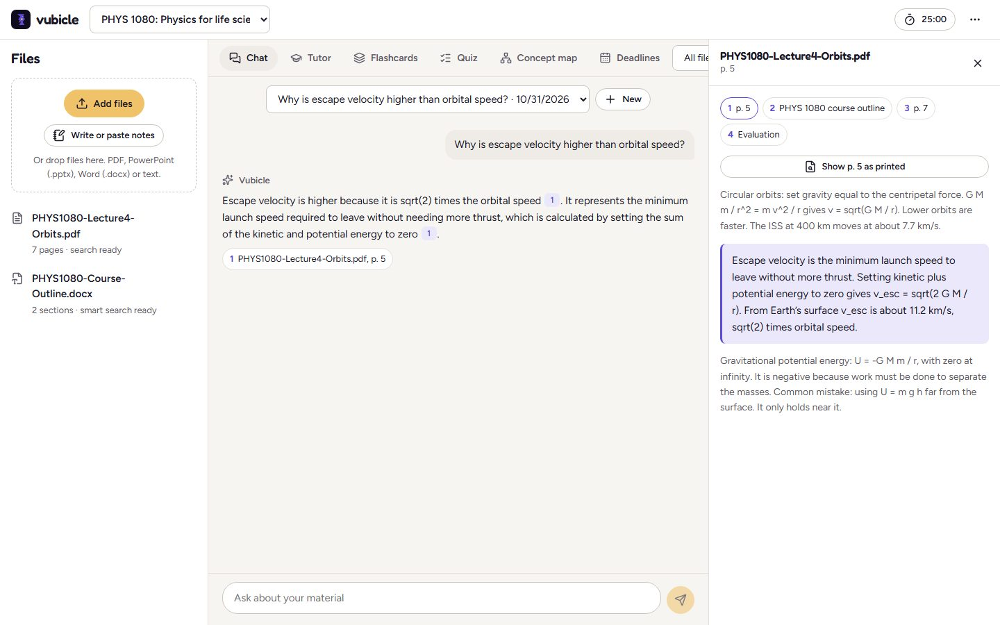
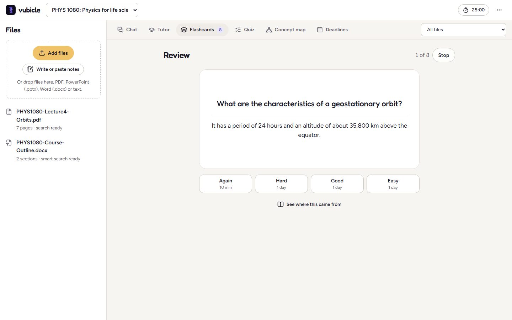
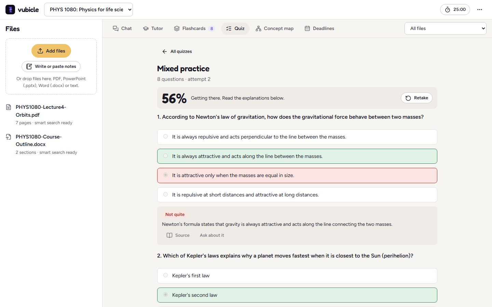
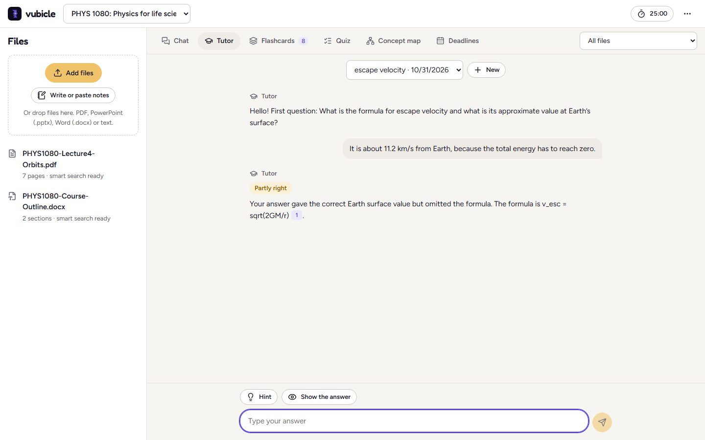
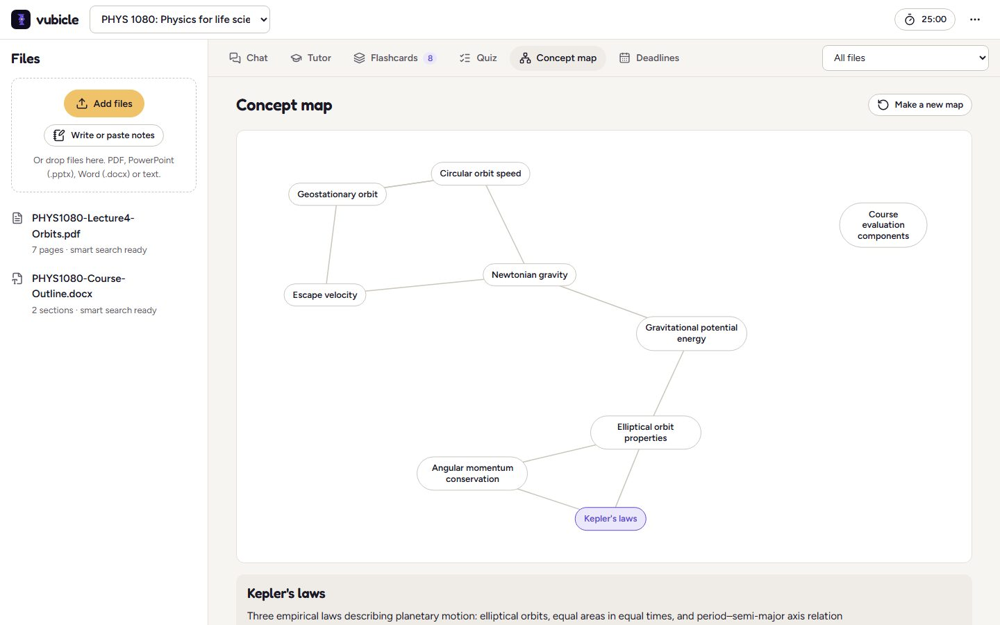
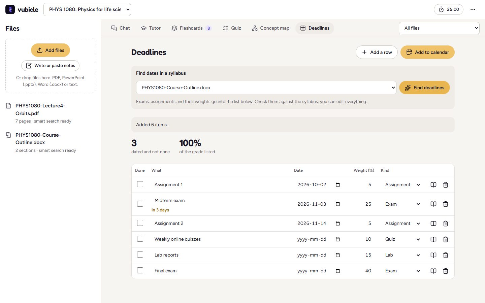
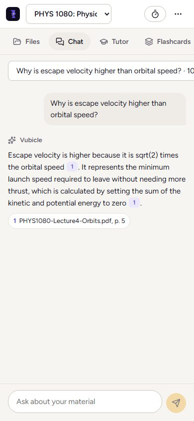
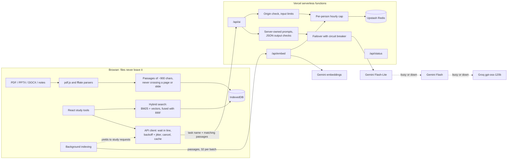
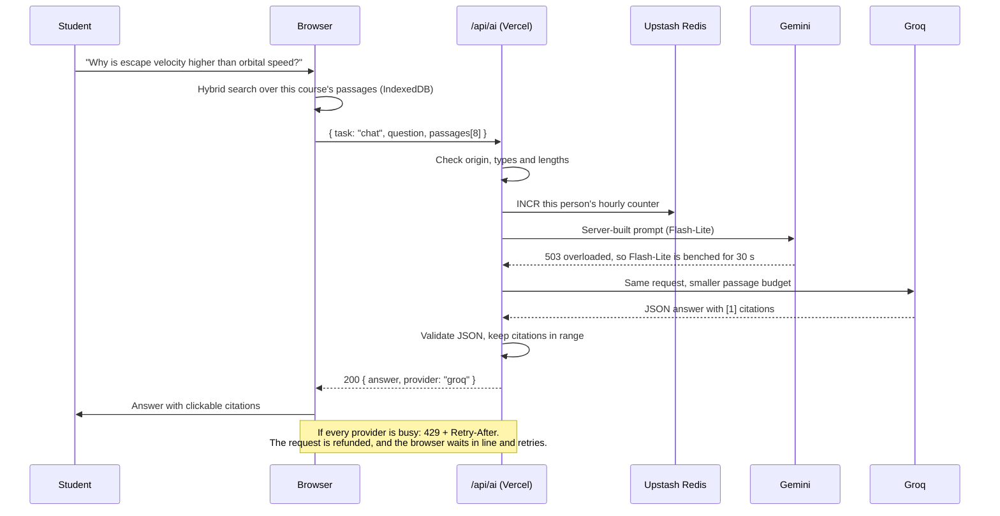

# Vubicle

[](https://github.com/ayaanalv/vubicle/actions/workflows/ci.yml)

**Live site: [vubicle.com](https://vubicle.com)** · Free to use · No account · Works on laptops and phones

Vubicle stands for **virtual cubicle**: one study workspace per course. A student makes a cubicle for a course, drops in the lecture slides, readings, syllabus and notes, and studies with AI tools that answer **only from that material** and **cite the page or slide** each answer came from.

It runs entirely on free tiers (Vercel Hobby, Google Gemini, Groq, Upstash Redis), so most of the interesting engineering is about staying reliable when any one free service is slow, overloaded or out of quota. It does that without making students download anything or see an error.


## Contents

- [Why I built it](#why-i-built-it)
- [What it does](#what-it-does), with a screenshot of every tool
- [Architecture](#architecture)
- [Engineering decisions](#engineering-decisions)
  - [Retrieval with page citations](#1-retrieval-with-page-citations)
  - [A serverless API with Gemini-to-Groq failover](#2-a-serverless-api-with-gemini-to-groq-failover)
  - [Per-person rate limiting with Upstash Redis](#3-per-person-rate-limiting-with-upstash-redis)
  - [The wait-in-line queue](#4-the-wait-in-line-queue)
  - [Smaller decisions](#5-smaller-decisions)
- [Security and privacy](#security-and-privacy)
- [Testing](#testing)
- [Performance and accessibility](#performance-and-accessibility)
- [Limits and trade-offs](#limits-and-trade-offs)
- [Run it locally](#run-it-locally) · [Deploy](#deploy) · [Project layout](#project-layout)

## Why I built it

I'm a second-year Computer Science student (AI emphasis) at the University of Guelph. My earlier project was a local RAG app that answered questions about PDFs with Ollama. It worked, but only on my machine, and only for people willing to install a model.

Vubicle is that idea rebuilt for real classmates:

- **Nothing to install, nothing to download.** In-browser models were ruled out because people won't wait for a multi-gigabyte download. The AI runs in the cloud behind my own serverless API.
- **$0 to run.** Every service is on a free tier, so the system has to treat rate limits and outages as normal, not exceptional.
- **Answers you can check.** Every claim links to the page or slide it came from. If the material doesn't cover a question, the app says so instead of guessing.

## What it does

### Cubicles and files

Each course gets its own cubicle. Students add **PDF, PowerPoint (.pptx), Word (.docx)** files or typed notes, and every file is read **in the browser**, with a progress bar. Studying can start as soon as the first file is stored. Old `.ppt`/`.doc` files and scanned PDFs (pages that are pictures, with no text) get a specific message saying what to do instead, such as "save it as .pptx" or "run it through text recognition first".

### Chat with citations



Ask anything about the course. Each claim carries a numbered citation. Clicking it opens the passage **in context**, with the passages before and after it, and for PDFs a button draws the printed page itself. Judgment questions like "what's the hardest idea here?" or "what should I focus on?" get an answer that picks an idea, says why, and cites the pages. "Not in your material" only appears when the facts needed to answer aren't in the files.

### Flashcards with spaced repetition



Cards are generated from the material, can be edited, or are written by hand. Reviews use **SM-2**: each grade button shows when the card will come back ("10 min", "1 day", "6 days"), so cards return right before they'd be forgotten. Reviews work from the keyboard (Space to flip, 1 to 4 to grade). Making more cards prefers passages that have no cards yet.

### Practice quizzes



Quizzes mix multiple choice and short answer. Multiple choice is graded instantly in the browser. Short answers are graded by the AI against the source passage, with **partial credit** in quarters and feedback on what was missing. Every question has an explanation, a link to its source, and an "Ask about it" shortcut into chat. Quizzes are saved, so a retake costs no AI calls.

### Tutor mode



The tutor asks **one question at a time** and judges each answer as correct, partly right or not quite, citing the notes. It gives **hints before answers** and only reveals an answer when asked or after two wrong tries. Sessions can focus on a topic or mix everything.

### Concept map



A map of the course's main topics and how they relate, drawn with a small force-directed layout written for this project. Every topic is a button. Picking one shows its summary and how it connects, with shortcuts to **ask about it, get quizzed on it, make flashcards**, or read its source passages.

### Deadline finder



Point it at a syllabus and it pulls out exams, assignments and their **weights** into a table you can edit and check off. Items due within a week are flagged, the listed weights are totalled, and the list exports to **Google, Apple or Outlook Calendar** as an `.ics` file. Running it again only adds new items, so your edits are never overwritten.

### And

- **Focus timer:** a Pomodoro timer in the top bar (25/5, with a long break every fourth round) that survives a page reload.
- **Backups:** export a cubicle, with its original files, to a `.vubicle` file and import it on another computer. Deleting a cubicle offers to export a backup first.
- **Light and dark themes** that follow the device or a manual choice.
- **Phones:** the same tools, rearranged for a narrow screen.



*All screenshots are from the live site, using sample physics material written for this README. The AI output in them is real. They're taken by a Playwright script ([`tests/e2e/readme.spec.ts`](tests/e2e/readme.spec.ts)), so they can be retaken after any UI change.*

## Architecture



### The life of one question



The browser does the work that touches the student's files: parsing, chunking, storing and searching. The server owns everything that touches a provider: prompts, keys, failover and rate limits. Only the handful of passages that match a request ever leave the browser.

## Engineering decisions

### 1. Retrieval with page citations

**The goal:** every answer should be checkable in one click, so a citation has to point at one specific place.

**Chunking around pages.** Parsers return text per page (PDF), per slide (PowerPoint, in presentation order, with speaker notes) or per heading (Word, which has no reliable pages). Each section is split into passages of about 900 characters on sentence boundaries, with one sentence of overlap. A passage **never crosses a page or slide**, so "p. 14" really means page 14. The sentence splitter only splits where whitespace follows a period, so a value like "11.2 km/s" stays whole (the first version split it into "11." and "2 km/s", which the screenshots caught).

**Hybrid search that degrades gracefully.**

| Layer | What it is | Why |
| --- | --- | --- |
| BM25 | Written for this project (k1 = 1.4, b = 0.75), with stop words and light suffix stripping | Runs in the browser with zero quota and zero latency, and works offline |
| Vectors | Gemini `gemini-embedding-001`, 768 dimensions, L2-normalized, rounded to 4 decimals | Finds passages that share meaning but no words with the question |
| Fusion | Reciprocal rank fusion, k = 60 | Merges two rankings without comparing incompatible scores |

Embeddings are added **in the background** after a file is stored, 32 passages at a time, so studying never waits on them. If the embedding service is unavailable, files are marked "keyword search" and everything keeps working.

**Grounded, but not literal.** The server prompt tells the model to use only the numbered passages, to cite after each claim, and to treat passage text as data (instructions inside a passage are ignored). Early testing showed this was too literal: asked "explain the hardest idea here simply", it answered that the material doesn't designate a hardest idea. The rule now covers **facts, not judgment**. For "hardest", "most important", "what to focus on" or "likely on the exam", the browser sends passages spread across the whole course instead of keyword hits. The model picks one, says why (how much space it gets, how much depends on it, what the slides call examinable), and cites the pages.

Code: [`src/lib/parse.ts`](src/lib/parse.ts), [`src/lib/chunk.ts`](src/lib/chunk.ts), [`src/lib/search.ts`](src/lib/search.ts), [`src/app/retrieve.ts`](src/app/retrieve.ts), [`api/_lib/tasks.ts`](api/_lib/tasks.ts)

### 2. A serverless API with Gemini-to-Groq failover

**The constraint:** free tiers fail all the time, in different ways. A model can return 429 (rate limited), 503 (overloaded), hang until a timeout, or return text that isn't the JSON we asked for.

**The order.** Gemini Flash-Lite first, then Gemini Flash (each Gemini model has its own free quota, so a second one adds headroom), then Groq's `gpt-oss-120b`. Model names are environment variables, so a retired model is a config change, not a code change.

**How each failure is handled:**

| What the provider does | What happens |
| --- | --- |
| Answers with valid JSON | Done. The answer is returned and the provider's bench is cleared |
| 429 rate limited | Benched for as long as it asks (its `Retry-After` or `retryDelay`), and the next provider is tried immediately |
| 5xx overloaded | Benched for 30 s, the next provider is tried, and it gets one more try at the end if time allows |
| Hangs past 15 s | Treated as down: benched for 2 min, and the next provider is tried |
| Returns broken JSON | Treated like a 5xx, because a second try usually works |
| 400/401/404 (bad key, unknown model) | Dropped for this request with no retry, because waiting won't fix it |

Two rules make this hold up: **every provider gets one try before any gets a second**, and **failures are remembered** (a circuit breaker), so the next request skips a benched provider without spending any time on it. Retries use exponential backoff with **full jitter**, so many clients retrying at once spread out. The whole request has a 50-second budget, under the function's 60-second limit.

**Groq gets less context.** Groq's free tier allows far fewer tokens per minute than Gemini's, so the prompt builder takes a per-provider budget: about 40,000 characters of passages for Gemini and 12,000 for Groq. It always keeps at least the top-ranked passage.

**The incident that shaped this.** After launch, a student uploaded four lecture PDFs (about 200 pages), clicked "Make cards", and waited **10 minutes**. The Vercel logs showed why (condensed):

```
22:02:14 /api/ai flashcards  busy after 45s   (no attempts logged)
22:03:14 /api/ai flashcards  gemini-3.8-flash=timeout/25s > gemini-3.8-flash=503/3s > gemini-3.5-flash-lite=200/1s
```

Gemini Flash was hanging for 25 seconds and then failing. The first version of the loop **retried the same model** and used up its budget before ever reaching Flash-Lite (which answered in 1 to 3 seconds every time) or Groq (never called). The fix was the two rules above, a shorter per-call timeout, Flash-Lite first, and logging every attempt even on failure. I then tested Groq inside Vercel by deploying a preview whose Gemini model name didn't exist: chat, flashcards and quizzes all came back from Groq in 3 to 4 seconds. On the next real slowdown in production, the logs read (condensed):

```
chat  gemini-3.5-flash-lite=timeout/15s > gemini-3.8-flash=429/0.2s > openai/gpt-oss-120b=200/0.7s
```

The student got an answer instead of a wait. A unit test replays that exact sequence.

**The server owns the prompts.** The browser sends a task name (`chat`, `tutor`, `flashcards`, `quiz`, `grade`, `map`, `deadlines`) and passages, never a prompt. That keeps the endpoint from becoming a free general-purpose chatbot, and lets the server check every model output against the shape it asked for: quiz questions need exactly 4 options and a valid answer index, scores are clamped to quarters, dates must be real `YYYY-MM-DD` dates, and citation numbers must point at a passage that was sent.

Code: [`api/_lib/failover.ts`](api/_lib/failover.ts), [`api/_lib/providers.ts`](api/_lib/providers.ts), [`api/_lib/tasks.ts`](api/_lib/tasks.ts), [`api/_lib/handler.ts`](api/_lib/handler.ts)

### 3. Per-person rate limiting with Upstash Redis

**The goal:** one heavy user (or one script) must not be able to spend the whole free quota.

- **Fixed one-hour window per person.** Each request runs `INCR rl:<person>:<hour>` in a Redis `MULTI` with `EXPIRE ... NX`, so the count and its expiry are set atomically. The default cap is 60 AI requests per hour (`HOURLY_CAP`).
- **Shared across instances.** Vercel runs many function instances, and an in-memory counter would let a person exceed the cap by landing on different ones. Redis makes the count global. Without Redis configured (local development), it falls back to memory, and the code says so in a `shortcut:` comment.
- **Private by design.** The "person" is a SHA-256 hash of the IP address (with an optional salt), so raw IPs never reach the store.
- **Fair refunds.** If every provider was busy and no model was called, the request is **refunded**, so waiting in line never uses up a student's allowance.
- **Indexing is counted separately.** Embedding calls use their own bucket (`rl:<person>:emb`, 5 times the cap), so indexing a 200-page course can't use up the requests chat, flashcards and quizzes need.
- **Over the cap** returns 429 with `error: "cap"` and the seconds until the window resets, which the browser turns into a plain message: "You have used this hour's free AI requests. The next one opens in 41 min."

Code: [`api/_lib/ratelimit.ts`](api/_lib/ratelimit.ts), [`api/_lib/handler.ts`](api/_lib/handler.ts)

### 4. The wait-in-line queue

**The goal:** when the free tiers are full, the student waits a minute instead of seeing an error, and is never left guessing.

- **Server side:** when every provider is busy, `/api/ai` answers **429 with `Retry-After`**: the time until the soonest benched provider is worth trying again, clamped to 3 to 60 seconds.
- **Browser side:** the request is kept and retried after the server's hint, or after exponential backoff (2 s, 4 s, 8 s, up to 60 s), plus up to 30% jitter. A retry is never scheduled sooner than 1 second.
- **Honest countdown.** The wait shows the **real time left** ("Next try in 12s"), or "Trying again now" while a request is in flight. It never shows "0s". (The first version did, for minutes, because the countdown hit zero while a slow request was still running. That's fixed and tested.)
- **Plain long waits.** After two minutes it says how long both services have been busy. An hourly-cap wait shows the actual minutes until the next request opens, and waits it out instead of failing. After 20 minutes of a busy service, it stops and says so.
- **Cancel.** Every wait has a Cancel button.
- **Never blocking.** The wait appears inline in the tool that asked, plus a small badge in the top bar. Everything else stays usable.
- **Indexing steps aside.** Background embedding pauses while any study request is running or waiting, and leaves 8 seconds between batches, so indexing never competes with a student who is waiting.

Code: [`src/app/api.ts`](src/app/api.ts), [`src/app/ui.tsx`](src/app/ui.tsx), [`src/app/ingest.ts`](src/app/ingest.ts)

### 5. Smaller decisions

- **Nothing is generated twice.** Flashcards, quizzes, concept maps and deadline lists are saved in IndexedDB. Identical chat questions, short-answer grading and syllabus scans are cached by a hash of the request. Reviewing and retaking cost no API calls.
- **AI output is never rendered as HTML.** A small renderer turns paragraphs, `- ` lists, `**bold**` and `[n]` citations into React elements. Nothing from a model reaches `innerHTML`.
- **Parsing without a DOM.** PPTX and DOCX are zip files of XML. They're unzipped with `fflate` and read with targeted patterns rather than `DOMParser`, which keeps the parsers small and testable in Node. pdf.js is loaded only when a PDF is added.
- **A landing page that stays light.** The landing page is static HTML: the painted hero art (AVIF, 36 to 67 KB) plus about 5 KB of gzipped script that adds a canvas motion layer and a live search demo. The demo runs the same BM25 code as the app, on a sample lecture, with no AI call.
- **Backups with fresh ids.** Imports re-key every record and remap every cross-reference (cards to passages, quiz questions to sources, chat citations), so importing the same backup twice never collides.
- **A force-directed map that stays readable.** The concept map layout is deterministic, so a saved map always looks the same. Its centre pull was tuned by measuring node spread on four graph shapes, after a real map showed one unlinked topic squeezing the rest into a corner.

## Security and privacy

- **Keys stay on the server.** The browser only talks to `/api/*` on its own origin. Gemini and Groq keys exist only as Vercel environment variables, and `/api/status` reports whether each is configured without showing values.
- **Only Vubicle's pages may call the API.** Requests must come from `vubicle.com` (or a Vercel preview of this project, or localhost in development). Origins can be forged outside a browser, which is why the hourly cap exists.
- **Every input is bounded:** request body (300 KB), passages per task (3 to 40), characters per passage (700 or 2,000), question length, history length, and card or question counts.
- **Prompt injection is contained.** Passage text and student answers are marked as data in every prompt, and outputs are validated against the expected shape, so a hostile PDF can't change what the endpoint does.
- **No accounts, no server copy.** Files and study data live in the student's browser (IndexedDB). Only the passages that match a request are sent, to Google Gemini or Groq. The landing page and the app's first screen say plainly that free tiers may use that text to improve their services, and that students shouldn't upload anything confidential.
- **Hardening headers** (`nosniff`, `DENY` framing, a strict referrer policy) are set in [`vercel.json`](vercel.json).

## Testing

**78 unit tests (Vitest)** cover the logic that's easy to get subtly wrong:

- **Parsing:** PDFs built in memory (including a "scanned" PDF with no text), PPTX with speaker notes and slide order, DOCX with and without headings, old Office files, damaged zips. Test fixtures are generated in code, so no binary files live in the repo.
- **Retrieval:** BM25 ranking, reciprocal rank fusion, the vector fallback, sentence splitting around decimals, and broad-question detection.
- **SM-2:** the 1-day, 6-day, then interval-times-ease sequence, the ease floor of 1.3, and resets.
- **Calendar export:** escaping, CRLF line endings, 75-octet line folding, and month rollover.
- **Failover:** a hung model followed by an overloaded one followed by Groq (the production incident), circuit-breaker benching, `Retry-After` and Gemini `retryDelay` parsing, one retry without thinking settings if a model rejects them, keys sent only in headers, and the real wait reported when everyone is benched.
- **Rate limiting:** cap, reset, refunds, and hashing.
- **API handler:** origins, bad input, the cap, the busy-with-refund path, Gemini-to-Groq through the full handler, and embedding validation.
- **Wait-in-line client:** real countdowns, "trying" while in flight, never 0, long cap waits, Cancel, and indexing yielding to study requests.

**15 end-to-end tests (Playwright)** drive the real app in Chromium at desktop and phone sizes, with `/api` intercepted by a mock ([`tests/mock-ai.ts`](tests/mock-ai.ts)), so they run without keys or network:

- the landing page and its search demo;
- file reading and its error messages;
- chat citations opening in context;
- the queue with a busy service, and a 41-minute cap with Cancel;
- the flashcard review loop with the keyboard;
- quiz grading and retakes;
- the tutor;
- the concept map handing off to chat;
- the deadline export (`.ics` contents checked);
- a backup round trip through delete and import;
- no horizontal scrolling and no controls pushed off screen on a phone;
- keyboard focus on the landing page.

## Performance and accessibility

- **Fast first load.** The landing page ships about 5 KB of gzipped script. The hero image went from a 2.8 MB JPEG to responsive AVIF/WebP (36 to 67 KB). The app loads separately (about 106 KB gzipped), and pdf.js (about 129 KB) loads only when a PDF is added.
- **Keyboard and screen readers.** Every control is a real button, link or labelled input. Dialogs use the native `<dialog>`, so focus is trapped and Escape closes them. There's a skip link, focus outlines are always visible, and the wait message announces its reason without reading the countdown aloud every second.
- **Contrast** was measured for every text and background pair in both themes, and all pass 4.5:1.
- **Touch targets** are at least 44 px on touch screens.
- **Reduced motion** turns off the hero animation and every transition.

## Limits and trade-offs

- **Free-tier logs are short.** Vercel Hobby keeps 30 minutes of runtime logs, which is why every failure now logs every provider attempt on one line.
- **The circuit breaker is per instance.** Bench times live in each function instance's memory. A cold instance may try a benched provider once (at most 15 seconds) before learning. Storing benches in Redis would share them, at the cost of a Redis call per request.
- **Scanned PDFs aren't read.** Vubicle detects them and explains what to do, but doesn't run OCR itself.
- **Browser storage can be cleared.** IndexedDB lives in one browser profile. Backups exist for that reason, and the app asks the browser for persistent storage.
- **The keyword search is English-first.** BM25's stop words and suffix stripping assume English. Vector search helps for other languages.

## Run it locally

```bash
npm install
npm run dev
```

Open http://localhost:5173. Without keys, the dev server answers AI requests from the same mock the tests use, so every tool works offline. To use the real providers, copy `.env.example` to `.env.local` and add your keys. The dev server runs the exact handlers Vercel does.

```bash
npm test          # 78 unit tests
npm run e2e       # 15 browser tests, AI mocked
npm run build     # type-check and production build
```

To retake the README screenshots on the live site (about eight real AI requests):

```bash
README_SHOTS=1 npx playwright test readme --project=desktop
```

## Deploy

1. Import the repo in Vercel (Hobby plan). It detects Vite, builds with `npm run build`, and serves `dist/` plus the functions in `api/`.
2. Add `GEMINI_API_KEY` and `GROQ_API_KEY` under **Settings > Environment Variables**. Add **Upstash for Redis** from the **Storage** tab; it sets `KV_REST_API_URL` and `KV_REST_API_TOKEN`, which the code reads. Everything else in [`.env.example`](.env.example) has a default.
3. Add your domain under **Settings > Domains** and enter the DNS records Vercel shows at your registrar.
4. Open `/api/status`. It should show both providers configured and `"rateLimitStore": "upstash"`.

## Project layout

```
index.html, src/landing/   landing page: static HTML, canvas motion over the hero art, live search demo
app/index.html, src/app/   the workspace (React): tools, IndexedDB, API client and queue, ingest
src/lib/                   pure, unit-tested logic: parsing, chunking, BM25 and fusion, SM-2, iCalendar, map layout
api/                       serverless functions: /api/ai, /api/embed, /api/status
api/_lib/                  prompts and output checks, providers, failover, rate limiting, request handling
tests/unit/                Vitest
tests/e2e/                 Playwright, plus the README screenshot script
tests/fixtures/            builds PDF, PPTX and DOCX test files in code
docs/screenshots/          README images
art/                       source illustrations; `npm run art` makes the AVIF/WebP sizes in public/art
```

---

Built by **Ayaan Alvi**, Computer Science (AI) at the University of Guelph. The illustrations were made by Ayaan with Gemini.
