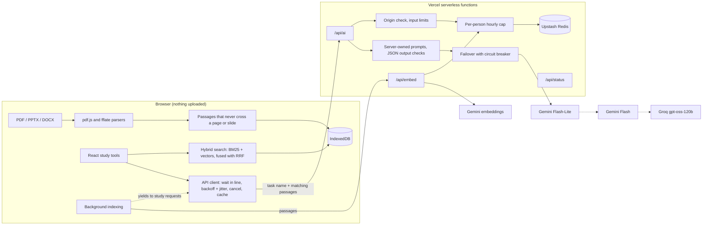

# Vubicle

**Live: [vubicle.com](https://vubicle.com)**

Vubicle stands for **virtual cubicle**: one study workspace per course. Students drop in their lecture slides, readings, syllabus and notes, then study with AI tools that answer only from that material and cite the page or slide every answer came from. It's free, needs no account, and keeps everything in the student's browser.


## The study tools

<table>
  <tr>
    <td width="50%"><br><b>Chat with citations.</b> Every claim links to its page or slide. Click a citation to read the passage in context, or see the printed PDF page.</td>
    <td width="50%"><br><b>Flashcards.</b> Made from your material or written by hand, then scheduled with SM-2 spaced repetition so each card returns right before you would forget it.</td>
  </tr>
  <tr>
    <td><br><b>Practice quizzes.</b> Multiple choice is graded instantly. Short answers are graded by the AI with partial credit. Every question has an explanation and a source link, and quizzes are saved for retakes.</td>
    <td><br><b>Tutor mode.</b> Asks one question at a time, checks the answer against your notes, and gives hints before answers.</td>
  </tr>
  <tr>
    <td><br><b>Concept map.</b> The course's main topics and how they connect. Pick one to ask about it, get quizzed on it, make cards or read its passages.</td>
    <td><br><b>Deadline finder.</b> Pulls exams, assignments and their weights out of a syllabus into a list you can edit, check off and add to your calendar (.ics).</td>
  </tr>
</table>

Also: PDF, PowerPoint (.pptx), Word (.docx) and typed notes, read in the browser with visible progress; a Pomodoro focus timer; light and dark themes; backups you can export and import; and a layout that works on phones.


*The screenshots are from the live site, with sample physics material written for this README. The AI output is real.*

## Architecture



Files never leave the browser. When a tool needs the AI, the browser picks the matching passages and sends only those, with a task name like `chat` or `quiz`. The server owns the prompt, calls the providers, checks the JSON that comes back, and returns it.

## Engineering decisions

### Retrieval with page citations

Each file is cut into passages that never cross a page or slide boundary, so every citation points to exactly one place a student can open. PowerPoint slides are read in presentation order with their speaker notes. Word files have no reliable pages, so they're split by headings. Search is hybrid: BM25 (written for this project) works offline with zero quota, and when Gemini embeddings are available, vector search runs alongside it. The two rankings are merged with reciprocal rank fusion, so raw scores never need comparing. If the embedding service is down, keyword search carries on. Judgment questions like "what is the hardest idea here?" get passages spread across the whole course, not just keyword hits, and the model may make that call as long as it says why and cites the pages. "Not in your material" is reserved for facts the files don't contain.
([`src/lib/search.ts`](src/lib/search.ts), [`src/lib/chunk.ts`](src/lib/chunk.ts), [`src/app/retrieve.ts`](src/app/retrieve.ts))

### A serverless API with Gemini-to-Groq failover

Everything runs on free tiers, so any one provider can be slow, overloaded or out of quota. Each request tries Gemini Flash-Lite, then Gemini Flash (each model has its own quota), then Groq. Every provider gets one try before any is retried, each call has a 15-second limit, and a provider that times out or returns 5xx is benched for a few minutes (a circuit breaker), so later requests skip it straight away. A 429 benches it for as long as the provider asks. Bad keys and unknown models are dropped without retrying. Groq's free tier allows far fewer tokens per minute, so it's sent a smaller slice of the passages.

The design comes from a real incident. In production, Gemini Flash started hanging for 25 seconds and then returning 503. The first version of the loop retried it, used up the whole time budget, and told students to wait, without ever trying Flash-Lite or Groq. The logs showed every attempt. The fix was "every provider once before anyone twice" plus the bench, and tests now replay that exact sequence: a hung model, an overloaded one, then Groq answering.
([`api/_lib/failover.ts`](api/_lib/failover.ts), [`api/_lib/providers.ts`](api/_lib/providers.ts))

The API also owns every prompt. The browser sends a task name and passages, never a prompt, and each input is checked for type and length. That stops the endpoint from being used as a free general-purpose chatbot. ([`api/_lib/tasks.ts`](api/_lib/tasks.ts))

### Per-person rate limiting with Upstash Redis

Each person gets an hourly allowance of AI requests: a fixed one-hour window counted in Upstash Redis, so every serverless instance sees the same count. IP addresses are hashed before they reach the store. Requests that never reached a model (because every provider was busy) are refunded. Background indexing is counted in its own bucket, so indexing a 200-page course can't use up the requests a student needs for chat, flashcards and quizzes. Only Vubicle's own pages may call the API; the cap is what actually holds, since origins can be forged outside a browser.
([`api/_lib/ratelimit.ts`](api/_lib/ratelimit.ts), [`api/_lib/handler.ts`](api/_lib/handler.ts))

### Waiting in line instead of errors

When every provider is busy, the server answers 429 with how long to wait. The browser keeps the request, waits for that hint (or its own exponential backoff, plus jitter), and tries again, while the rest of the app stays usable. The wait shows the real time left, or "trying again now" while a try is in flight. It never shows "0s". Long waits are stated plainly ("You have used this hour's free AI requests. The next one opens in 41 min.") and can be cancelled. Background indexing pauses while any study request is running or waiting.
([`src/app/api.ts`](src/app/api.ts), [`src/app/ui.tsx`](src/app/ui.tsx))

### Smaller decisions

- **Nothing is generated twice.** Cards, quizzes, maps and deadlines are saved. Identical chat questions, grading requests and syllabus scans come from a local cache, so reviewing and retaking cost no API calls.
- **AI output is never HTML.** A small parser turns paragraphs, lists, bold and `[n]` citations into React elements. No HTML from the model reaches the page.
- **Privacy is stated, not buried.** The landing page and the app's first screen say that matching passages go to Google Gemini or Groq, that free tiers may use that text, and that you shouldn't upload anything confidential.

## Tech

- **Front end:** Vite, React 19 and TypeScript. The landing page is static HTML with about 5 KB of script, and pdf.js loads only when a PDF is added.
- **Storage:** IndexedDB via `idb`. No accounts, no server-side copy.
- **API:** Vercel serverless functions using Web `Request`/`Response`, Upstash Redis, and Gemini and Groq over REST.
- **Tests:** 78 Vitest unit tests (parsing, search, SM-2, calendar export, failover, rate limiting, the wait-in-line client, the API handler) and 15 Playwright tests of the main flows on desktop and phone sizes. The AI is mocked, so tests need no keys.

## Run it locally

```bash
npm install
npm run dev
```

Open http://localhost:5173. Without keys, the dev server answers AI requests from a built-in mock ([`tests/mock-ai.ts`](tests/mock-ai.ts)), so every tool works offline. To use the real providers, copy `.env.example` to `.env.local` and add your keys; the dev server runs the same handlers Vercel does.

```bash
npm test          # unit tests
npm run e2e       # browser tests, AI mocked
npm run build     # type-check and build
```

## Deploy

1. Import the repo in Vercel (Hobby plan). It builds with `npm run build` and serves `dist/` plus `api/`.
2. Add `GEMINI_API_KEY` and `GROQ_API_KEY` under Settings > Environment Variables, and add Upstash for Redis from the Storage tab (it sets `KV_REST_API_URL` and `KV_REST_API_TOKEN`). See [`.env.example`](.env.example) for the rest, which have defaults.
3. Add your domain under Settings > Domains and enter the DNS records Vercel shows.
4. Open `/api/status`. It reports which providers and which rate-limit store are configured, without showing any key.

Model names are environment variables (`GEMINI_MODELS`, `GROQ_MODEL`, `GEMINI_EMBED_MODEL`), so retiring a model needs no code change.

## Project layout

```
index.html, src/landing/   landing page (static HTML, canvas motion over the hero art, live search demo)
app/index.html, src/app/   the workspace (React)
src/lib/                   pure, unit-tested logic: parsing, chunking, search, SM-2, iCalendar, map layout
api/                       serverless functions; api/_lib holds providers, failover, rate limit, prompts
tests/                     Vitest unit tests, Playwright browser tests, and the README screenshot script
art/                       source illustrations; `npm run art` makes the AVIF/WebP sizes in public/art
```

Built by Ayaan Alvi, Computer Science (AI) at the University of Guelph. The illustrations were made by Ayaan with Gemini.
