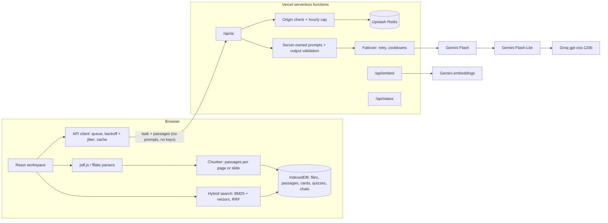

# Vubicle

**Vubicle** stands for **virtual cubicle**: one study workspace per course. Students drop in their slides, readings, syllabus and notes, then study with AI tools that answer only from that material and cite the page or slide each answer came from.

Live at [vubicle.com](https://vubicle.com). It's free to use, needs no account, and stores everything in your browser.

## What it does

- **Cubicles.** You make one per course. Each holds many files, and every tool can use all of them or just one.
- **Files.** It reads PDF, PowerPoint (.pptx), Word (.docx) and typed notes right in the browser, with visible progress. Old .ppt/.doc files and scanned PDFs get a clear message explaining what to do instead.
- **Chat with citations.** Answers cite passages like [2]. Clicking one opens the passage in context, and for PDFs you can see the printed page.
- **Flashcards.** Cards are generated from your material or written by hand. You can edit them, and they're scheduled with SM-2 spaced repetition.
- **Practice quizzes.** Multiple choice is graded instantly. Short answers are graded by the AI with partial credit. Every question has an explanation and a source link, and quizzes are saved for retakes.
- **Tutor mode.** The tutor asks one question at a time, checks your answer against your notes, and gives hints before answers.
- **Concept map.** Shows the course's main topics and how they link. Clicking a topic leads to chat, the tutor, flashcards or its passages.
- **Deadline finder.** Pulls exam and assignment dates and weights out of a syllabus into an editable checklist, which you can export to your calendar as `.ics`.
- **Focus timer.** A Pomodoro timer in the top bar.
- **Backups.** You can export a cubicle to a `.vubicle` file and import it on another computer. Deleting a cubicle offers to export a backup first.

## Architecture



Files never leave the browser. When a tool needs the AI, the browser picks the matching passages and sends only those, along with a task name like `chat` or `quiz`. The server builds the prompt, calls the providers, checks the JSON that comes back, and returns it.

## Engineering decisions

**Prompts live on the server.** The API takes a task name and passages, never a prompt. Every input is checked for type and length. That's what stops someone from using the API as a free general-purpose chatbot. The origin check and the hourly cap protect the quota. Origin headers can be forged outside a browser, so the cap is what actually holds. ([`api/_lib/tasks.ts`](api/_lib/tasks.ts))

**Failover across free tiers.** Providers are tried in order: Gemini Flash, then Gemini Flash-Lite (it has its own quota), then Groq. A 429 moves straight to the next provider and remembers a cooldown, so later requests on that instance skip the busy provider. A 5xx or timeout gets one retry with exponential backoff and full jitter. A bad key or an unknown model is skipped without a retry. If the model returns broken JSON, it's treated as a transient failure and retried. Each provider gets its own context budget, because Groq's free tier allows far fewer tokens per minute than Gemini's. ([`api/_lib/failover.ts`](api/_lib/failover.ts))

**Waiting in line instead of errors.** When every provider is busy, the server returns 429 with `Retry-After` and refunds the request against the hourly cap. The browser keeps the request, waits for the server's hint or its own backoff (plus jitter), and tries again. While it waits, it shows a calm countdown, and the rest of the app stays usable. ([`src/app/api.ts`](src/app/api.ts))

**Hybrid retrieval that survives losing embeddings.** Passages are indexed with BM25, written for this project, which works offline and with zero quota. When Gemini embeddings are available, vector search runs too, and the two rankings are merged with reciprocal rank fusion, so raw scores never need comparing. Embeddings are added in the background after a file is stored, so studying starts right away. If the embedding service is down, keyword search still works. ([`src/lib/search.ts`](src/lib/search.ts))

**Citations that point somewhere real.** Passages never cross a page or slide boundary, so each citation maps to exactly one place. PowerPoint slides are read in presentation order with their speaker notes. Word files have no reliable pages, so they're split by headings. ([`src/lib/parse.ts`](src/lib/parse.ts), [`src/lib/chunk.ts`](src/lib/chunk.ts))

**Nothing is generated twice.** Cards, quizzes, maps and deadlines are saved. Identical chat questions, grading requests and syllabus scans come back from a local cache, so reviewing and retaking cost no API calls.

**AI output is never HTML.** Answers are rendered by a small parser that understands paragraphs, lists, bold and `[n]` citations, and builds React elements from them. No HTML from the model reaches the page.

**Privacy.** The landing page and the first screen of the app both say that matching passages go to Google Gemini or Groq, that free tiers may use that text to improve their services, and that you shouldn't upload anything confidential. IP addresses are hashed before they touch the rate-limit store.

## Tech

- **Front end:** Vite, React 19 and TypeScript. The landing page is static HTML with about 5 KB of script. The app loads separately, and pdf.js loads only when a PDF is added.
- **Storage:** IndexedDB, via `idb`.
- **Parsing:** pdf.js for PDFs. PPTX and DOCX are unzipped with fflate and their XML read directly.
- **API:** Vercel serverless functions (Node, Web `Request`/`Response`), with Upstash Redis for the hourly cap.
- **Tests:** Vitest for unit tests and Playwright for end-to-end tests. The AI is mocked, so tests need no keys.

## Run it locally

```bash
npm install
npm run dev
```

Open http://localhost:5173. Without keys, the dev server answers AI requests from a built-in mock ([`tests/mock-ai.ts`](tests/mock-ai.ts)), so every tool works offline. To use the real providers, copy `.env.example` to `.env.local` and add your keys. The dev server runs the same handlers Vercel does.

```bash
npm test          # unit tests: parsing, search, SM-2, calendar export, failover, rate limiting, API handler
npm run e2e       # browser tests of the main flows on desktop and phone sizes, with the AI mocked
npm run build     # type-check and build
```

## Deploy

1. Push the repo to GitHub, then import it in Vercel (Hobby plan). Vercel builds with `npm run build` and serves `dist/` plus `api/`.
2. In Vercel > Project > Settings > Environment Variables, add the variables from [`.env.example`](.env.example): `GEMINI_API_KEY`, `GROQ_API_KEY`, `UPSTASH_REDIS_REST_URL` and `UPSTASH_REDIS_REST_TOKEN` are required. The rest have defaults.
3. In Vercel > Domains, add `vubicle.com` and `www.vubicle.com`, then enter the DNS records Vercel shows at your registrar.
4. Open `https://vubicle.com/api/status`. It reports which providers and which rate-limit store are configured, without ever showing a key.

Model names are environment variables (`GEMINI_MODELS`, `GROQ_MODEL`, `GEMINI_EMBED_MODEL`), so retiring a model needs no code change.

## Project layout

```
index.html, src/landing/   landing page (static HTML, canvas motion over the hero art, live search demo)
app/index.html, src/app/   the workspace (React)
src/lib/                   pure logic shared and unit-tested: parsing, chunking, search, SM-2, iCalendar, map layout
api/                       serverless functions; api/_lib holds providers, failover, rate limit, prompts
tests/unit, tests/e2e      Vitest and Playwright
art/                       source illustrations; `npm run art` makes the AVIF/WebP sizes in public/art
```

The illustrations are by Ayaan Alvi, made with Gemini.
